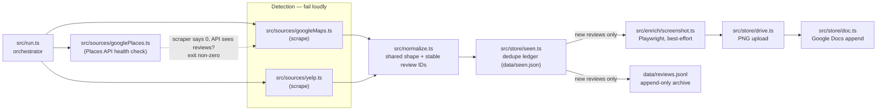

# restaurants-review

Restaurant review intelligence with a search bar. Point it at a restaurant and
it monitors that restaurant's **Google Maps** and **Yelp** reviews daily,
appending every new review — text, rating, date, permalink, and a best-effort
screenshot — to a Google Doc you own. Duplicate rows are treated as the
cardinal sin: every review gets a stable ID, and a ledger guarantees each one
is appended exactly once.

## Architecture



Three layers with different failure contracts:

| Layer | Job | On failure |
| --- | --- | --- |
| **Detection** (`googleMaps.ts`, `yelp.ts`) | Decide *that* a review is new, plus its core fields | Fail loudly, non-zero exit |
| **Health check** (`googlePlaces.ts`) | Independently confirm the detector isn't silently broken | Fail loudly |
| **Enrichment** (`screenshot.ts`) | Full text + PNG of the review card | Warn, write the row anyway |

The Places API is deliberately a health check, **not** a second detector: the
current API returns 5 reviews by relevance, so it can miss a brand-new review,
and its IDs differ from the scraper's — merging the two paths would create
duplicates. See [`docs/architecture.md`](docs/architecture.md) for the full
reasoning, including the OAuth scope decision (`drive.file` only).

### Dedupe keys

- **Google** — the API's review resource `name`, which is stable. Trust it.
- **Yelp** — no stable ID exposed. Primary key is `author + reviewDate`, with a
  hash of the first 80 characters of text only as a tiebreaker for the same
  author reviewing twice on one day. Text is deliberately *not* part of the
  primary key: if it were, an edited review would resurface as new.

IDs are namespaced by restaurant, so multiple targets can share one ledger.

## Getting started

Requires Node >= 22 and Chrome (Playwright drives the real installed Chrome).

```bash
npm ci
cp .env.example .env                              # fill in values
cp config/targets.example.json config/targets.json  # your restaurant's URLs
npm run authorize                                 # one-time OAuth consent
```

Google Cloud setup (API key, OAuth client, consent screen) is a one-time
15-minute job — [`SETUP.md`](SETUP.md) walks through every step, including the
non-obvious parts: why the app creates the Doc itself, why the consent screen
must be published, and how to schedule the daily run with launchd
([`launchd/com.example.reviews.plist`](launchd/com.example.reviews.plist)).

## Commands

| Command | What it does |
| --- | --- |
| `npm test` | Offline unit tests over `tests/fixtures/`. No network, ever. |
| `npm run typecheck` | `tsc --noEmit` |
| `npm run check -- --dry-run` | Live fetch, prints rows, writes nothing |
| `npm run check` | Real run: fetch, dedupe, screenshot, append |
| `npm run resolve-place-id -- "Name, City"` | Fill in the optional Places ID for the health check |
| `npm run diagnose` | Environment and credentials sanity check |

## Repository rules

1. **Tests never hit the network.** A test that calls Google or Yelp is a bug —
   add a fixture to `tests/fixtures/` instead. CI runs with no secrets.
2. **Fixtures are redacted** — no API keys, no real reviewer names.
3. **Dedupe correctness outranks everything.** After any change to ID
   derivation or a parser, run `npm run check` twice; the second run must
   append zero rows.
4. **No stealth.** When a scraper breaks, the answer is never stealth plugins,
   proxies, or CAPTCHA solvers. One polite request per day is what keeps this
   defensible.

## License

[Apache-2.0](LICENSE)
